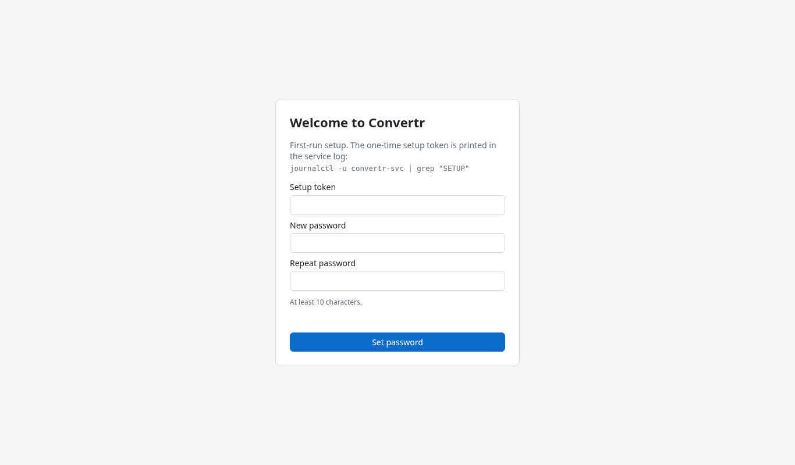
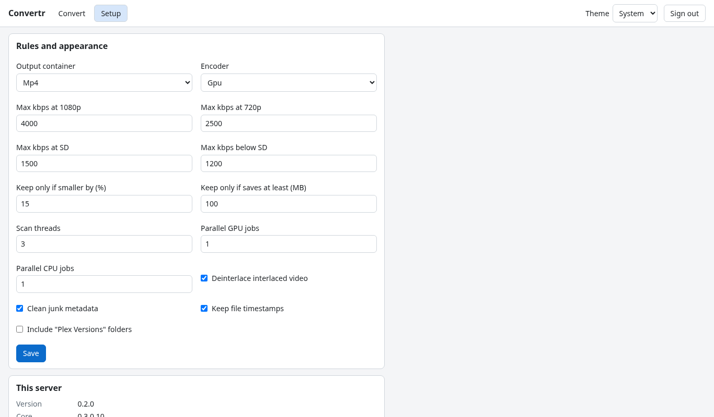
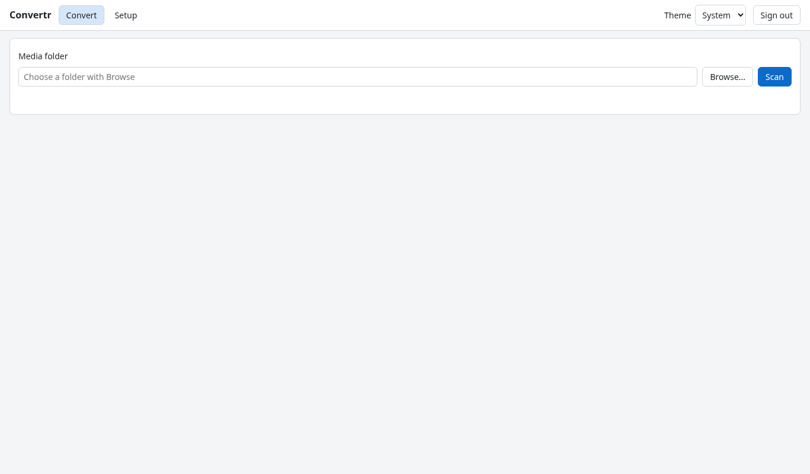
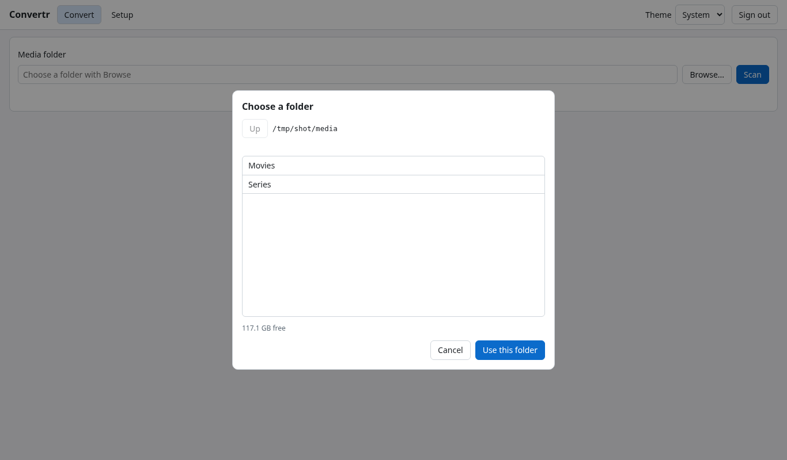
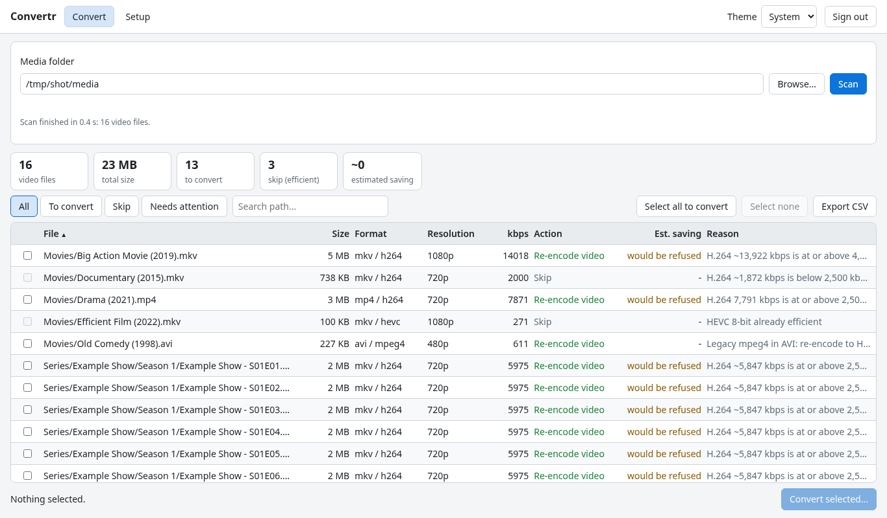
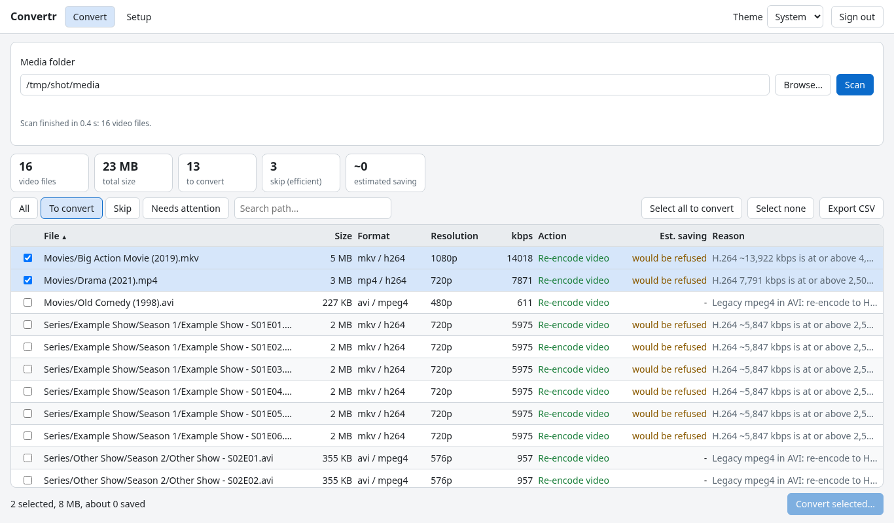

# Convertr_svc user guide (v0.3.4: web page, scan, convert, NAS, undo)

Convertr_svc is the server edition of **Convertr**, the Windows app. It runs as a service on the Linux server and you use it from a web page. It uses the same engine as the Windows app: it reads your Media folder, works out which files should be converted so that they play directly in Plex, and converts them safely. Every file is converted on a local scratch disk, checked, and only a smaller, verified result is swapped in. The original is moved to `_Convertr_Originals`, **never deleted**, and **Undo** puts it back.

## Quick start

> **Note:** the IP addresses in this document (172.16.0.x, for example 172.16.0.12 for the server and 172.16.0.35 for the NAS) are placeholder examples for documentation only, not real addresses. Use your own server and NAS addresses, and replace `media-server` with your server's host name.

1. Open `http://172.16.0.12:8484` (or `http://media-server:8484`) and sign in.
2. **Setup**: check that **Hardware** shows the Intel GPU working and that **Check mount** passes for the NAS.
3. **Convert** tab: press **Browse...**, pick a folder, **Use this folder**, then **Scan**.
4. Press **Select all to convert** (or tick a few rows first to try), then **Convert selected...**.
5. Read the dialog. Tick **Dry run** if you only want to see the ffmpeg commands. Press **Start converting**.
6. Watch it on the **Queue** tab.

## Built and tested on
- Ubuntu 24.04.5 LTS, kernel 7.0.0-38-generic
- Intel Arc Pro B60 GPU with the `xe` kernel driver
- Intel graphics userspace from the `kobuk-team/intel-graphics` PPA (intel-media-va-driver-non-free 26.3.2, libva 2.24)
- jellyfin-ffmpeg 7.1.4
- .NET 10 (SDK 10.0.402, runtime 10.0.13; the release is published self-contained, so the server needs no .NET install)

Other distributions and GPUs may work but are untested.

## Opening the page

- On the home network: `http://172.16.0.12:8484` or `http://media-server:8484`.
- It is plain HTTP on purpose. It is meant for the home LAN only; do not open it to the internet.
- The browser keeps a sign-in for each address, so the IP and the name each need their own sign-in.
- **Theme** (System, Light, Dark) and **Sign out** are at the top right.

## First run: setup token and password



The very first time, the page asks for a **Setup token** and a new password (at least 10 characters, typed twice). The token is printed in the service log on the server:

```bash
journalctl -u convertr-svc | grep "SETUP"
```

Enter it, choose the password and press **Set password**. After that you just sign in with the password. You can change it in **Setup > Change password**. Lost the password? On the server run `sudo -u convertr /opt/convertr-svc/convertr-svc --reset-password`; it prints a new setup token.

## Setup page



Each panel has its own **Save** button.

- **Rules and appearance:** output container (Mp4 or Mkv), encoder **Mode** (Gpu = Intel Arc, fast; Cpu = smallest files, very slow), max kbps per resolution, keep-only-if-smaller (% and MB), scan threads, parallel jobs, deinterlace, clean junk metadata, keep file timestamps, include "Plex Versions" folders.
- **Encoder and scratch disk:**
  - Recommended (the default): **Intel VAAPI HEVC, quality 23**. About 13x faster than real time, files about 30 % of the source size, very close to the source in quality.
  - **QSV quality 21**: the alternative, same quality and size, a bit slower.
  - **CPU x265**: about 20 % smaller files at the same quality, but about 0.6x real time (roughly 3 hours per movie).
  - **AV1**: not tested and not benchmarked. Only use it if you want to experiment.
  - Lower quality numbers mean better pictures and bigger files.
  - **Scratch folder:** each file is copied to this local disk, converted there, and only a smaller verified result is copied back. The folder must be empty the first time and outside the media folders. Keep **Use the local scratch disk** ticked for the NAS.
- **This server:** version, platform, ffprobe, the allowed folders and the scratch disk.

### Network storage (NAS)

Connects the NAS media share (NFS) to the server. The service never mounts anything itself and never gets root rights; it shows you the commands to run once with `sudo`.

1. Enter the NAS host (`172.16.0.35`), the shared folder, the mount point (`/mnt/nas-media`), the NFS version and the media folder.
2. **List shares on the NAS** shows what the NAS offers and whether this server is allowed. **Use this share** fills in the form.
3. **Show the commands** shows the DSM steps for the NAS, the `/etc/fstab` line and the one-time commands, with **Copy** buttons and **Copy all commands**. Run them on the server.
4. **Allowed folders:** the service can only use folders in its allowed list. This list cannot be changed from the web page (a safety rule); the page prints the command to use when it is needed.
5. **Check mount** looks from inside the service: is it really a mounted share, free space, can it write and rename, can `_Convertr_Originals` be created next to the media folder. Every line says OK, Note, Problem or Skipped, with the fix. It only creates tiny hidden test files and removes them.

## Hardware

The **Hardware** panel shows the Intel GPU, the render device and which encoder is **In use**. Press **Detect hardware / test Intel GPU** to test the encoders again (a few seconds). **Test log** shows the details, including ffmpeg's own error text if a test fails.

## Browse and Scan



Press **Browse...**. The dialog shows only the allowed folders; click a folder to open it, **Up** to go back, then **Use this folder**.



Press **Scan** (**Cancel** stops it). The cards on top show the totals and the estimated saving; the note under them says what the estimate is based on.



- The table: File, Size, Format, Resolution, kbps, Action, Est. saving, Reason.
- Filters: **All**, **To convert**, **Skip**, **Needs attention**, and a path search.
- **Select all to convert**, **Select none**, or tick rows yourself. Nothing is selected at first.
- **Export CSV** saves the plan.



## Convert dialog and warnings

**Convert selected...** opens **Convert selected files?** with the number of files, the source size, the expected result and saving, and the scratch space needed.

- **Warnings** (it can still start), for example: some files will probably be kept as they are (saving too small); the Intel GPU has not been tested yet; scratch is off; a file is too big for the scratch budget.
- **Blockers** (it cannot start), for example: no files selected, scan a folder first, ffmpeg not found, scratch folder not set or too small, the Intel GPU encoder does not work, originals cannot be moved, a run is already active.
- **Dry run** only writes the ffmpeg commands to the log; nothing is changed.
- **Start converting** starts it; **Cancel** closes the dialog.

## Queue page and Log

The **Queue** tab shows the run (the tab shows how many files are left) with a progress bar and a table: File, State, Size, Result, Progress / note. A waiting file can be removed with **Remove**.

- **Pause** / **Resume**: pause and continue.
- **Stop after this file**: the current file finishes, then it stops.
- **Stop now**: the running file is cancelled, its temporary files are deleted and the original is untouched. Waiting files stay in the queue.
- **Resume queue**: carries on with the files that are still waiting.
- **Discard queue**: forgets the queue. Nothing already converted is changed.
- **Log** (click it to open): the newest run log, live. A dry run shows the exact ffmpeg command for each file; a real run shows each file's steps and how much was saved. It also shows the file's path on the server.

A dry run changes nothing. A real run copies each file to scratch, converts, checks, keeps it only if it is smaller, copies it back, moves the original to `_Convertr_Originals` and keeps the old file dates.

## Results and Undo

The **Undo** panel on the Queue tab lists converted files. Tick files and press **Undo selected**.

- The original comes back from `_Convertr_Originals` with its old date.
- The converted file is moved to `_Convertr_Undone`, not deleted.
- Undo works while the original is still in `_Convertr_Originals`.

Both folders sit next to the Media folder you chose, on the same share. Originals are never deleted by Convertr_svc.

## Where the files are

- Logs: `/var/lib/convertr-svc/logs/` (`Convertr_<date>_<time>.log`, and the undo journals `undo_*.csv`). Also in the journal: `sudo journalctl -u convertr-svc -n 100 --no-pager`.
- Settings and data: `/var/lib/convertr-svc`. Server configuration: `/etc/convertr-svc/appsettings.json`. Program: `/opt/convertr-svc`.

## Updating to a new version

1. The new tarball is in `C:\Projects\Convertr_svc` on the Windows PC (`convertr-svc-<version>-linux-x64.tar.gz`).
2. Copy it with WinSCP to `/home/youruser` on the server.
3. On the server:

```bash
cd ~
tar xzf convertr-svc-<version>-linux-x64.tar.gz && cd convertr-svc-<version>-linux-x64
sudo ./scripts/install.sh --media-root /mnt/nas-media
```

Add `--dry-run` first if you want to see what it would do. **Do not use `--scratch`**: it resets the scratch folder's permissions. The installer keeps your `appsettings.json`, settings, password, logs and undo history, updates the program and service, and restarts it. Then reload the web page and check the version under **Setup > This server**.

## Troubleshooting

- **Page does not open:** check the service with `systemctl status convertr-svc`. For the name, `ping media-server` must answer from 172.16.0.12.
- **Intel GPU test fails:** see the Hardware **Test log**, and the README [Troubleshooting](../README.md#troubleshooting).
- **NAS problems:** run **Check mount** and follow the fix on each line.
- **Where is the log of a run:** Queue > **Log**, or `/var/lib/convertr-svc/logs/`.

More in the [README](../README.md#troubleshooting) and [DESIGN.md](DESIGN.md).

Copyright (C) 2026 JeepNWilly
